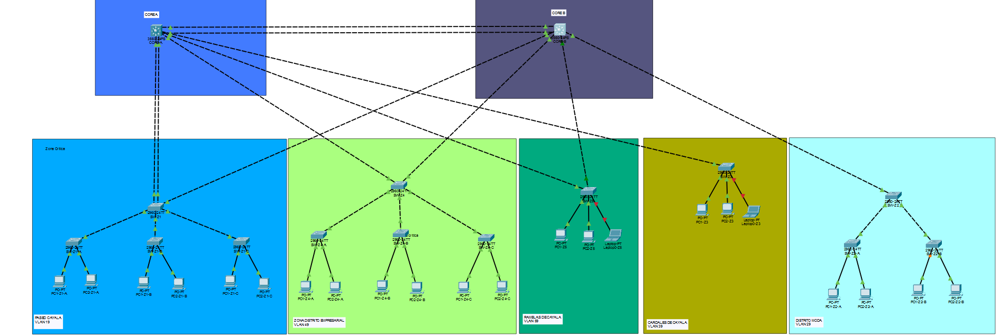
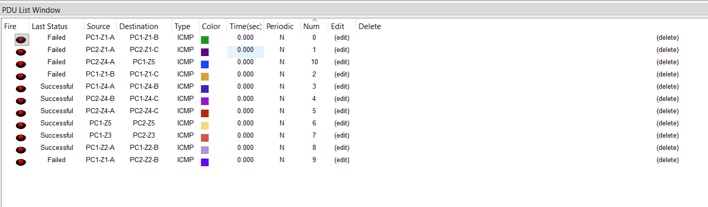

# Manual Técnico – Práctica 2
## Red de la Ciudad Comercial Cayalá

| | |
|---|---|
| **Curso** | Redes de Computadoras 1 – Segundo Semestre 2026 |
| **Estudiante** | Henry García |
| **Carné** | 201407949 |
| **Herramienta** | Cisco Packet Tracer (switches configurados únicamente por CLI) |
| **Repositorio** | `Redes1_2S2026` → carpeta `Practica2` |

> Las imágenes se encuentran en la carpeta `imagenes/` y se referencian con el nombre indicado debajo de cada título.

---

## Índice
1. [Introducción](#1-introducción)
2. [Parámetros derivados del carné](#2-parámetros-derivados-del-carné)
3. [Análisis de las zonas de Cayalá](#3-análisis-de-las-zonas-de-cayalá)
4. [Diseño de la topología](#4-diseño-de-la-topología)
5. [Segmentación con VLANs y direccionamiento](#5-segmentación-con-vlans-y-direccionamiento)
6. [VTP](#6-vtp)
7. [STP (Rapid PVST+)](#7-stp-rapid-pvst)
8. [EtherChannel](#8-etherchannel)
9. [Implementación por dispositivo](#9-implementación-por-dispositivo)
10. [Verificación y pruebas](#10-verificación-y-pruebas)
11. [Problemas encontrados y soluciones](#11-problemas-encontrados-y-soluciones)
12. [Presupuesto estimado en quetzales](#12-presupuesto-estimado-en-quetzales)
13. [Estructura del repositorio y reproducción](#13-estructura-del-repositorio-y-reproducción)
14. [Conclusiones](#14-conclusiones)
15. [Anexo: lista de imágenes a incluir](#15-anexo-lista-de-imágenes)

---

## 1. Introducción

La empresa administradora de Ciudad Cayalá requiere modernizar su red para interconectar zonas comerciales, corporativas y residenciales. Se diseñó e implementó en Cisco Packet Tracer una red de capa 2 segmentada con **una VLAN por zona**, interconectada mediante enlaces troncales, con **VTP**, **Rapid PVST+** y **EtherChannel**, y con enrutamiento entre VLANs en un switch multicapa para verificar la conectividad entre zonas.

**Objetivos**
- Diseñar una topología híbrida justificada según el rol, la criticidad y el tráfico de cada zona.
- Configurar VLANs, VTP, Rapid PVST+ y EtherChannel exclusivamente por CLI.
- Verificar conectividad dentro de cada zona (mínimo 10 pings exitosos) y entre zonas.

**Vista general de la topología**



---

## 2. Parámetros derivados del carné

| Parámetro | Regla del enunciado | Valor aplicado |
|---|---|---|
| Último dígito | – | **9** (impar) |
| IDs de VLAN de zona | `1X`, `2X`, `3X`, `4X`, `5X` | **19, 29, 39, 49, 59** |
| Dominio VTP | Número de carné | **201407949** |
| Contraseña VTP | Libre | `Cayala2026` |
| Protocolo EtherChannel | Par → LACP, impar → PAgP | **PAgP** (`mode desirable`) |
| VLAN nativa | Fija | **99** |
| VLAN blackhole | Fija | **999** (puertos sin uso, en `shutdown`) |

---

## 3. Análisis de las zonas de Cayalá

Las zonas se seleccionaron a partir del sitio oficial y de fuentes públicas sobre Ciudad Cayalá. La cantidad de hosts de cada VLAN proviene de la tabla del enunciado.

| Zona | Área real | VLAN | Hosts requeridos | Rol operativo | Criticidad |
|---|---|---|---|---|---|
| 1 | **Paseo Cayalá** | 19 | 60 | Zona comercial principal: tiendas, restaurantes, cine y servicios. Usuarios: visitantes, comercios y personal. | **Alta** |
| 2 | **Distrito Moda** | 29 | 28 | Torres de oficinas, hotel y restaurantes. Usuarios: empleados y huéspedes. | Media |
| 3 | **Cardales de Cayalá** | 39 | 12 | Plaza de bienestar y entretenimiento: gimnasios y vida nocturna. | Media-baja |
| 4 | **Distrito Empresarial** | 49 | 50 | Torres corporativas y administración. Usuarios: empresas y personal administrativo. | **Alta** |
| 5 | **Ramblas de Cayalá** | 59 | 7 | Área residencial: áreas comunes, control de acceso y videovigilancia. | Media (por seguridad) |

### 3.1 Volumen de tráfico estimado

| Zona | Hosts | Tipo de actividad | Tráfico estimado |
|---|---|---|---|
| Paseo Cayalá | 60 | Comercial: puntos de venta, Wi-Fi de visitantes, cámaras | **Alto** |
| Distrito Empresarial | 50 | Administrativa: correo, ERP, videollamadas | **Alto** |
| Distrito Moda | 28 | Oficinas y servicios hoteleros | Medio |
| Cardales | 12 | Servicios de entretenimiento | Bajo-medio |
| Ramblas | 7 | Residencial: acceso y vigilancia | Bajo |

### 3.2 Criticidad

- **Paseo Cayalá** y **Distrito Empresarial** son críticas: una caída afecta ventas, operaciones corporativas y a muchos usuarios a la vez. Cuentan con **más de un enlace físico** hacia la red.
- **Ramblas** tiene pocos hosts, pero concentra el control de accesos y las cámaras del área residencial, por lo que se conectó a **ambos cores**.
- **Distrito Moda** y **Cardales** tienen impacto moderado y reciben **un solo enlace** hacia un core.

---

## 4. Diseño de la topología


### 4.1 Topología híbrida

La red combina **tres esquemas** (el enunciado exige al menos dos):

| Esquema | Dónde se aplica | Por qué |
|---|---|---|
| **Estrella** | Cada zona se conecta a los cores con su switch principal | Administración centralizada y fallos aislados por zona |
| **Árbol (jerárquico)** | Dentro de cada zona: switch principal → switches de acceso → hosts | Escala por cantidad de hosts y mantiene el tráfico local en la zona |
| **Malla parcial** | Dos cores interconectados, con zonas críticas conectadas a ambos | Redundancia sin el costo de una malla completa |

La jerarquía es: **2 switches core (3560)** → **5 switches principales de zona (2960)** → **8 switches de acceso (2960)** → hosts.

### 4.2 Justificación de cada enlace físico

| # | Enlace | Tipo | Justificación técnica |
|---|---|---|---|
| 1 | CORE-A Gi0/1-2 ↔ CORE-B Gi0/1-2 | EtherChannel PAgP (Po1) | Interconexión de cores. Dos enlaces agregados duplican la capacidad y toleran la caída de un cable. Transporta todas las VLAN de zona. |
| 2 | CORE-A Fa0/1-2 ↔ SW-Z1 Fa0/1-2 | EtherChannel PAgP (Po2) | Paseo Cayalá concentra 60 hosts y tráfico comercial alto: requiere mayor capacidad y redundancia entre enlaces. |
| 3 | CORE-B Fa0/1 ↔ SW-Z1 Fa0/3 | Troncal | Tercer enlace de Paseo Cayalá hacia el otro core: respaldo si falla CORE-A. |
| 4 | CORE-A Fa0/3 ↔ SW-Z4 Fa0/1 | Troncal | Distrito Empresarial es crítico: primer enlace de alta disponibilidad. |
| 5 | CORE-B Fa0/2 ↔ SW-Z4 Fa0/2 | Troncal | Segundo enlace de Distrito Empresarial hacia un core distinto (cumple el mínimo de 2 enlaces). |
| 6 | CORE-A Fa0/4 ↔ SW-Z5 Fa0/1 | Troncal | Ramblas: control de acceso y cámaras requieren continuidad. |
| 7 | CORE-B Fa0/3 ↔ SW-Z5 Fa0/2 | Troncal | Segundo camino de Ramblas hacia el core B. |
| 8 | CORE-A Fa0/5 ↔ SW-Z3 Fa0/1 | Troncal | Cardales: criticidad media-baja y 12 hosts; un enlace es suficiente. |
| 9 | CORE-B Fa0/4 ↔ SW-Z2 Fa0/1 | Troncal | Distrito Moda: 28 hosts y criticidad media; un enlace es suficiente. |
| 10-12 | SW-Z1 Fa0/4, Fa0/5, Fa0/6 ↔ SW-Z1-A, B, C Fa0/1 | Troncal | Paseo Cayalá reparte sus 60 hosts en 3 switches de acceso (24 puertos cada uno). |
| 13-14 | SW-Z2 Fa0/2, Fa0/3 ↔ SW-Z2-A, B Fa0/1 | Troncal | Distrito Moda reparte 28 hosts en 2 switches de acceso. |
| 15-17 | SW-Z4 Fa0/3, Fa0/4, Fa0/5 ↔ SW-Z4-A, B, C Fa0/1 | Troncal | Distrito Empresarial reparte 50 hosts en 3 switches de acceso. |

**Total:** 19 cables entre switches (los enlaces 1 y 2 usan 2 cables cada uno) y 22 cables hacia hosts.

### 4.3 Dominios de colisión

Un switch crea un dominio de colisión **por cada puerto**. No hay hubs en la red y todos los enlaces trabajan en dúplex completo punto a punto.

| Concepto | Cantidad |
|---|---|
| Enlaces entre switches | 19 |
| Enlaces switch–host | 22 |
| **Total de dominios de colisión** | **41** |
| Dominios de broadcast con hosts (VLANs) | 5 (19, 29, 39, 49, 59) |

**Dispositivos que los delimitan:** los 15 switches (2 core 3560 y 13 de 2960), a través de cada uno de sus puertos. Los dos cables de un EtherChannel siguen siendo dos dominios de colisión físicos distintos.

**Por qué es adecuada esta segmentación:** al dedicar un dominio de colisión a cada host, desaparece la competencia por el medio y se elimina el riesgo de colisiones. Las 5 VLANs limitan además el tráfico de broadcast a cada zona, de modo que el volumen de una zona (por ejemplo Paseo Cayalá) no degrada a las demás.

### 4.4 Estándar de cableado

Se aplica TIA/EIA-568B.

| Conexión | Cable | Observación |
|---|---|---|
| Switch ↔ Switch (core, principales, accesos) | **Cruzado (crossover)** | Un extremo en 568A y el otro en 568B (líneas punteadas en Packet Tracer) |
| Switch ↔ PC / laptop | **Directo (straight-through)** | 568B en ambos extremos (líneas continuas) |

**Medios de enlace distintos:** en la simulación se usa cobre UTP Cat6. En una implementación física se recomienda **fibra óptica** para los enlaces entre cores y hacia las zonas (distancias mayores a 100 m entre edificios) y UTP Cat6 para el acceso a los hosts.

---

## 5. Segmentación con VLANs y direccionamiento

### 5.1 Tabla de VLANs

| VLAN | Nombre | Zona | Hosts requeridos | Hosts en simulación | Uso |
|---|---|---|---|---|---|
| 19 | PASEO_CAYALA | 1 | 60 | 6 | Datos |
| 29 | DISTRITO_MODA | 2 | 28 | 4 | Datos |
| 39 | CARDALES | 3 | 12 | 3 | Datos |
| 49 | DISTRITO_EMPRESARIAL | 4 | 50 | 6 | Datos |
| 59 | RAMBLAS | 5 | 7 | 3 | Datos |
| 99 | NATIVA_ADMIN | – | – | – | VLAN nativa de los troncales |
| 999 | BLACKHOLE | – | – | – | Puertos sin uso (apagados) |

> En la simulación se colocó una muestra de hosts por zona; las subredes se dimensionaron para la cantidad total de hosts que requiere cada zona.

### 5.2 Direccionamiento IP

| Zona | VLAN | Red | Máscara | Hosts útiles | Rango útil | Broadcast | Gateway |
|---|---|---|---|---|---|---|---|
| 1 | 19 | 10.19.0.0/26 | 255.255.255.192 | 62 | 10.19.0.1 – 10.19.0.62 | 10.19.0.63 | 10.19.0.1 |
| 2 | 29 | 10.29.0.0/27 | 255.255.255.224 | 30 | 10.29.0.1 – 10.29.0.30 | 10.29.0.31 | 10.29.0.1 |
| 3 | 39 | 10.39.0.0/28 | 255.255.255.240 | 14 | 10.39.0.1 – 10.39.0.14 | 10.39.0.15 | 10.39.0.1 |
| 4 | 49 | 10.49.0.0/26 | 255.255.255.192 | 62 | 10.49.0.1 – 10.49.0.62 | 10.49.0.63 | 10.49.0.1 |
| 5 | 59 | 10.59.0.0/28 | 255.255.255.240 | 14 | 10.59.0.1 – 10.59.0.14 | 10.59.0.15 | 10.59.0.1 |

**Justificación de máscaras:** /26 aloja 62 hosts (necesarios 60 y 50), /27 aloja 30 (necesarios 28) y /28 aloja 14 (necesarios 12 y 7). Un /29 solo permitiría 6 hosts, insuficiente para la zona 5.

### 5.3 Direcciones de los equipos

| Equipo | IP | Máscara | Gateway |
|---|---|---|---|
| PC1-Z1-A / PC2-Z1-A | 10.19.0.11 / .12 | 255.255.255.192 | 10.19.0.1 |
| PC1-Z1-B / PC2-Z1-B | 10.19.0.13 / .14 | 255.255.255.192 | 10.19.0.1 |
| PC1-Z1-C / PC2-Z1-C | 10.19.0.15 / .16 | 255.255.255.192 | 10.19.0.1 |
| PC1-Z2-A / PC2-Z2-A | 10.29.0.11 / .12 | 255.255.255.224 | 10.29.0.1 |
| PC1-Z2-B / PC2-Z2-B | 10.29.0.13 / .14 | 255.255.255.224 | 10.29.0.1 |
| PC1-Z3 / PC2-Z3 / Laptop0-Z3 | 10.39.0.11 / .12 / .13 | 255.255.255.240 | 10.39.0.1 |
| PC1-Z4-A / PC2-Z4-A | 10.49.0.11 / .12 | 255.255.255.192 | 10.49.0.1 |
| PC1-Z4-B / PC2-Z4-B | 10.49.0.13 / .14 | 255.255.255.192 | 10.49.0.1 |
| PC1-Z4-C / PC2-Z4-C | 10.49.0.15 / .16 | 255.255.255.192 | 10.49.0.1 |
| PC1-Z5 / PC2-Z5 / Laptop0-Z5 | 10.59.0.11 / .12 / .13 | 255.255.255.240 | 10.59.0.1 |

### 5.4 Enrutamiento entre VLANs

El **CORE-A** es el gateway de todas las VLANs mediante interfaces virtuales (SVI) con `ip routing`. El **CORE-B** actúa como camino redundante de capa 2 y no tiene SVIs, para evitar dos gateways con la misma dirección. Esto conserva el aislamiento de capa 2 entre VLANs y permite la conectividad entre zonas a través del gateway.

| SVI | Dirección |
|---|---|
| Vlan 19 | 10.19.0.1/26 |
| Vlan 29 | 10.29.0.1/27 |
| Vlan 39 | 10.39.0.1/28 |
| Vlan 49 | 10.49.0.1/26 |
| Vlan 59 | 10.59.0.1/28 |

### 5.5 Troncales y VLANs permitidas

Todos los troncales usan 802.1Q con **VLAN nativa 99** y permiten **solo las VLANs necesarias** (no `all`).

| Enlace | VLANs permitidas |
|---|---|
| Po1 (CORE-A ↔ CORE-B) | 19, 29, 39, 49, 59, 99 |
| Enlaces de la zona 1 | 19, 99 |
| Enlaces de la zona 2 | 29, 99 |
| Enlaces de la zona 3 | 39, 99 |
| Enlaces de la zona 4 | 49, 99 |
| Enlaces de la zona 5 | 59, 99 |

Los puertos sin uso están en modo acceso, asignados a la **VLAN 999** y en `shutdown`.

---

## 6. VTP

| Parámetro | Valor |
|---|---|
| Versión | 2 |
| Dominio | `201407949` |
| Contraseña | `Cayala2026` |

| Switch | Modo VTP |
|---|---|
| SW-Z1, SW-Z2, SW-Z3, SW-Z4, SW-Z5 (principales de zona) | **Servidor** |
| SW-Z1-A, B, C · SW-Z2-A, B · SW-Z4-A, B, C (accesos) | **Cliente** |
| CORE-A, CORE-B | **Cliente** |

**Justificación:** el enunciado pide un servidor VTP en el switch principal de cada zona y clientes en los demás. Las VLANs se crean **una sola vez en SW-Z1** y se propagan al resto, lo que evita que dos servidores con bases de datos distintas se sobrescriban entre sí.

---

## 7. STP (Rapid PVST+)

Todos los switches usan `spanning-tree mode rapid-pvst`. El switch principal de cada zona se configuró como **root bridge de su VLAN** con prioridad explícita; los cores quedan como respaldo.

| VLAN | Root bridge | Prioridad | Respaldo |
|---|---|---|---|
| 19 | SW-Z1 | 4096 | CORE-A (8192), CORE-B (12288) |
| 29 | SW-Z2 | 4096 | CORE-A (8192), CORE-B (12288) |
| 39 | SW-Z3 | 4096 | CORE-A (8192), CORE-B (12288) |
| 49 | SW-Z4 | 4096 | CORE-A (8192), CORE-B (12288) |
| 59 | SW-Z5 | 4096 | CORE-A (8192), CORE-B (12288) |

**Justificación:** el tráfico de cada VLAN se origina en su zona. Con el principal de la zona como raíz, el árbol de expansión se ordena desde ese switch y el tráfico dentro de la zona no tiene que subir al core. Las prioridades 8192 y 12288 en los cores aseguran que, si falla la raíz, el nuevo root sea siempre un core y no un switch de acceso.

---

## 8. EtherChannel

| Port-channel | Extremos | Protocolo | Miembros |
|---|---|---|---|
| Po1 | CORE-A ↔ CORE-B | **PAgP** (`desirable`) | Gi0/1, Gi0/2 |
| Po2 | CORE-A ↔ SW-Z1 | **PAgP** (`desirable`) | Fa0/1, Fa0/2 |

**Justificación:** el carné termina en 9 (impar), por lo que se usa PAgP. Se aplica EtherChannel en **Paseo Cayalá** por su cantidad de hosts (60) y su tráfico comercial alto, y entre los cores porque concentran el tráfico entre todas las zonas. Además, STP trata el canal como un solo enlace lógico y no bloquea ninguno de sus miembros, lo que aprovecha el ancho de banda agregado.

---

## 9. Implementación por dispositivo

Cada dispositivo se configuró en tres fases:

| Fase | Contenido | Dónde |
|---|---|---|
| **Fase 1** | Nombre, VTP, STP, EtherChannel y troncales | Los 15 switches |
| **Fase 2** | Creación de las VLANs | Solo SW-Z1 (se propagan por VTP) |
| **Fase 3** | Troncales restringidos, puertos de acceso, root bridge, blackhole y SVIs | Los 15 switches |

Los scripts completos están en `scripts_cli/` y los comandos exactos se incluyen allí.

### 9.1 CORE-A (3560-24PS)

- **Rol:** VTP cliente. Gateway de las 5 VLANs (SVIs con `ip routing`). Prioridad STP 8192.
- **Puertos:** Gi0/1-2 → Po1 (CORE-B) · Fa0/1-2 → Po2 (SW-Z1) · Fa0/3 → SW-Z4 · Fa0/4 → SW-Z5 · Fa0/5 → SW-Z3
- **Script:** [`scripts_cli/01_CORE-A.txt`](scripts_cli/01_CORE-A.txt)

**Fase 1** – `01_CORE-A-fase 1.png`


**Fase 3** – `01_CORE-A-fase 3.png`


### 9.2 CORE-B (3560-24PS)

- **Rol:** VTP cliente. Camino redundante de capa 2, sin SVIs. Prioridad STP 12288.
- **Puertos:** Gi0/1-2 → Po1 (CORE-A) · Fa0/1 → SW-Z1 · Fa0/2 → SW-Z4 · Fa0/3 → SW-Z5 · Fa0/4 → SW-Z2
- **Script:** [`scripts_cli/02_CORE-B.txt`](scripts_cli/02_CORE-B.txt)

**Fase 1** – `02_CORE-B-fase 1.png`


**Fase 3** – `02_CORE-B-fase 3.png`


### 9.3 SW-Z1 (2960-24TT)

- **Rol:** VTP servidor. Root bridge de la VLAN 19 (4096). Crea las VLANs en la Fase 2.
- **Puertos:** Fa0/1-2 → Po2 (CORE-A) · Fa0/3 → CORE-B · Fa0/4-6 → SW-Z1-A, B, C
- **Script:** [`scripts_cli/03_SW-Z1.txt`](scripts_cli/03_SW-Z1.txt)

**Fase 1** – `03_SW-Z1-fase 1.png`


**Fase 2** (creación de VLANs) – `03_SW-Z1-fase 2.png`


**Fase 3** – `03_SW-Z1-fase 3.png`


### 9.4 SW-Z2 (2960-24TT)

- **Rol:** VTP servidor. Root bridge de la VLAN 29 (4096).
- **Puertos:** Fa0/1 → CORE-B · Fa0/2-3 → SW-Z2-A, B
- **Script:** [`scripts_cli/04_SW-Z2.txt`](scripts_cli/04_SW-Z2.txt)

**Fase 1** – `04_SW-Z2-fase 1.png`


**Fase 3** – `04_SW-Z2-fase 3.png`


### 9.5 SW-Z3 (2960-24TT)

- **Rol:** VTP servidor. Root bridge de la VLAN 39 (4096). Hosts conectados directamente (Fa0/2-4).
- **Puertos:** Fa0/1 → CORE-A · Fa0/2-4 → PC1-Z3, PC2-Z3, Laptop0-Z3
- **Script:** [`scripts_cli/05_SW-Z3.txt`](scripts_cli/05_SW-Z3.txt)

**Fase 1** – `05_SW-Z3-fase 1.png`


**Fase 3** – `05_SW-Z3-fase 3.png`


### 9.6 SW-Z4 (2960-24TT)

- **Rol:** VTP servidor. Root bridge de la VLAN 49 (4096).
- **Puertos:** Fa0/1 → CORE-A · Fa0/2 → CORE-B · Fa0/3-5 → SW-Z4-A, B, C
- **Script:** [`scripts_cli/06_SW-Z4.txt`](scripts_cli/06_SW-Z4.txt)

**Fase 1** – `06_SW-Z4-fase 1.png`


**Fase 3** – `06_SW-Z4-fase 3.png`


### 9.7 SW-Z5 (2960-24TT)

- **Rol:** VTP servidor. Root bridge de la VLAN 59 (4096). Hosts conectados directamente (Fa0/3-5).
- **Puertos:** Fa0/1 → CORE-A · Fa0/2 → CORE-B · Fa0/3-5 → PC1-Z5, PC2-Z5, Laptop0-Z5
- **Script:** [`scripts_cli/07_SW-Z5.txt`](scripts_cli/07_SW-Z5.txt)

**Fase 1** – `07_SW-Z5-fase 1.png`


**Fase 3** – `07_SW-Z5-fase 3.png`


### 9.8 SW-Z1-A (2960-24TT)

- **Rol:** VTP cliente. Acceso VLAN 19.
- **Puertos:** Fa0/1 → SW-Z1 Fa0/4 · Fa0/2-3 → PCs
- **Script:** [`scripts_cli/08_SW-Z1-A.txt`](scripts_cli/08_SW-Z1-A.txt)

**Fase 1** – `08_SW-Z1-A-fase 1.png`


**Fase 3** – `08_SW-Z1-A-fase 3.png`


### 9.9 SW-Z1-B (2960-24TT)

- **Rol:** VTP cliente. Acceso VLAN 19.
- **Puertos:** Fa0/1 → SW-Z1 Fa0/5 · Fa0/2-3 → PCs
- **Script:** [`scripts_cli/09_SW-Z1-B.txt`](scripts_cli/09_SW-Z1-B.txt)

**Fase 1** – `09_SW-Z1-B-fase 1.png`


**Fase 3** – `09_SW-Z1-B-fase 3.png`


### 9.10 SW-Z1-C (2960-24TT)

- **Rol:** VTP cliente. Acceso VLAN 19.
- **Puertos:** Fa0/1 → SW-Z1 Fa0/6 · Fa0/2-3 → PCs
- **Script:** [`scripts_cli/10_SW-Z1-C.txt`](scripts_cli/10_SW-Z1-C.txt)

**Fase 1** – `10_SW-Z1-C-fase 1.png`


**Fase 3** – `10_SW-Z1-C-fase 3.png`


### 9.11 SW-Z2-A (2960-24TT)

- **Rol:** VTP cliente. Acceso VLAN 29.
- **Puertos:** Fa0/1 → SW-Z2 Fa0/2 · Fa0/2-3 → PCs
- **Script:** [`scripts_cli/11_SW-Z2-A.txt`](scripts_cli/11_SW-Z2-A.txt)

**Fase 1** – `11_SW-Z2-A-fase 1.png`


**Fase 3** – `11_SW-Z2-A-fase 3.png`


### 9.12 SW-Z2-B (2960-24TT)

- **Rol:** VTP cliente. Acceso VLAN 29.
- **Puertos:** Fa0/1 → SW-Z2 Fa0/3 · Fa0/2-3 → PCs
- **Script:** [`scripts_cli/12_SW-Z2-B.txt`](scripts_cli/12_SW-Z2-B.txt)

**Fase 1** – `12_SW-Z2-B-fase 1.png`


**Fase 3** – `12_SW-Z2-B-fase 3.png`


### 9.13 SW-Z4-A (2960-24TT)

- **Rol:** VTP cliente. Acceso VLAN 49.
- **Puertos:** Fa0/1 → SW-Z4 Fa0/3 · Fa0/2-3 → PCs
- **Script:** [`scripts_cli/13_SW-Z4-A.txt`](scripts_cli/13_SW-Z4-A.txt)

**Fase 1** – `13_SW-Z4-A-fase 1.png`


**Fase 3** – `13_SW-Z4-A-fase 3.png`


### 9.14 SW-Z4-B (2960-24TT)

- **Rol:** VTP cliente. Acceso VLAN 49.
- **Puertos:** Fa0/1 → SW-Z4 Fa0/4 · Fa0/2-3 → PCs
- **Script:** [`scripts_cli/14_SW-Z4-B.txt`](scripts_cli/14_SW-Z4-B.txt)

**Fase 1** – `14_SW-Z4-B-fase 1.png`


**Fase 3** – `14_SW-Z4-B-fase 3.png`


### 9.15 SW-Z4-C (2960-24TT)

- **Rol:** VTP cliente. Acceso VLAN 49.
- **Puertos:** Fa0/1 → SW-Z4 Fa0/5 · Fa0/2-3 → PCs
- **Script:** [`scripts_cli/15_SW-Z4-C.txt`](scripts_cli/15_SW-Z4-C.txt)

**Fase 1** – `15_SW-Z4-C-fase 1.png`


**Fase 3** – `15_SW-Z4-C-fase 3.png`


---

## 10. Verificación y pruebas

### 10.1 Comandos de verificación

**`show vtp status`** – esperado: Dominio `201407949`, versión 2, modo servidor/cliente


**`show vlan brief`** – esperado: VLANs 19, 29, 39, 49, 59, 99 y 999


**`show interfaces trunk`** – esperado: Native 99 y VLANs permitidas restringidas


**`show etherchannel summary`** – esperado: Po1 y Po2 con protocolo PAgP en estado (SU)


**`show spanning-tree vlan 19`** – esperado: Root bridge SW-Z1, prioridad 4096


**`show spanning-tree vlan 29`** – esperado: Root bridge SW-Z2


**`show spanning-tree vlan 39`** – esperado: Root bridge SW-Z3


**`show spanning-tree vlan 49`** – esperado: Root bridge SW-Z4


**`show spanning-tree vlan 59`** – esperado: Root bridge SW-Z5


**`show spanning-tree summary`** – esperado: Modo rapid-pvst


**`show ip route` (CORE-A)** – esperado: 5 redes conectadas (10.19, 10.29, 10.39, 10.49, 10.59)


**`show ip interface brief` (CORE-A)** – esperado: SVIs activas


**`show vlan id 999`** – esperado: Puertos sin uso en la VLAN blackhole


### 10.2 Conectividad dentro de cada zona (mínimo 10 pings exitosos por zona)

**Zona 1 – Paseo Cayalá** (`ping 10.19.0.12`)


**Zona 2 – Distrito Moda** (`ping 10.29.0.12`)


**Zona 3 – Cardales** (`ping 10.39.0.12`)


**Zona 4 – Distrito Empresarial** (`ping 10.49.0.12`)


**Zona 5 – Ramblas** (`ping 10.59.0.12`)


### 10.3 Conectividad entre zonas

Desde `PC1-Z1-A` hacia una PC de cada una de las otras zonas, a través del gateway en CORE-A.



### 10.4 Prueba de redundancia

Se desconectó un enlace de una zona con doble uplink y se comprobó que la conectividad continúa.


---

## 11. Problemas encontrados y soluciones

| # | Problema | Causa | Solución |
|---|---|---|---|
| 1 | Mensajes `%DTP-5-DOMAINMISMATCH` en la consola de CORE-A | Los switches vecinos todavía no tenían el dominio VTP configurado | Es esperado durante la configuración. Dejaron de aparecer al aplicar la Fase 1 en los demás switches con el mismo dominio y contraseña |
| 2 | `show etherchannel summary` mostraba **LACP** en lugar de PAgP | Quedaba configuración de un script de ejemplo con `channel-group mode active` | Se eliminaron los channel-group y port-channel y se reconfiguraron con `channel-protocol pagp` y `mode desirable`, como corresponde a un carné impar |
| 3 | Aparecían VLANs 10, 20, 30, 40 y 50 en la base de datos | Configuración heredada del script de ejemplo | Al crear las VLANs 19-59 en SW-Z1 con un número de revisión mayor, VTP reemplazó la base de datos de los clientes. Se verificó con `show vlan brief` |
| 4 | Comandos incompletos al pegar el script (`xit`, `end` desconocido) | La consola de Packet Tracer pierde caracteres con pegados largos | Se pegaron los scripts en bloques cortos y se verificó con `show running-config` |
| 5 | Los IDs de VLAN estaban como 10-50 | Se habían calculado con el último dígito 0 | Se corrigieron a 19, 29, 39, 49 y 59 según el carné 201407949 |
| 6 | El servidor VTP estaba en el core | Diseño inicial distinto al requerido | Se movió el rol de servidor a los switches principales de zona y los cores pasaron a cliente |
| 7 | Enlaces con triángulo rojo hacia las laptops | El puerto aún negociaba con STP o el cable no era el adecuado | Se esperó la convergencia de Rapid PVST+ y se verificó el tipo de cable (directo) y que el puerto no estuviera en `shutdown` |

---

## 12. Presupuesto estimado en quetzales


| # | Concepto | Unidad | Cantidad | Precio unitario | Subtotal |
|---|---|---|---|---|---|
| 1 | Switch multicapa Cisco Catalyst 3560-24PS (core) | unidad | 2 | Q 8,500.00 | Q 17,000.00 |
| 2 | Switch Cisco Catalyst 2960-24TT (principales y acceso) | unidad | 13 | Q 3,800.00 | Q 49,400.00 |
| 3 | Computadora de escritorio (hosts) | unidad | 20 | Q 4,200.00 | Q 84,000.00 |
| 4 | Laptop (hosts) | unidad | 2 | Q 5,800.00 | Q 11,600.00 |
| 5 | Rack / gabinete de pared 6U (1 core + 5 zonas) | unidad | 6 | Q 2,800.00 | Q 16,800.00 |
| 6 | UPS 1000 VA | unidad | 6 | Q 1,900.00 | Q 11,400.00 |
| 7 | Patch panel 24 puertos Cat6 | unidad | 6 | Q 650.00 | Q 3,900.00 |
| 8 | Cable UTP Cat6, caja de 305 m (≈ 790 m necesarios) | caja | 3 | Q 1,250.00 | Q 3,750.00 |
| 9 | Conectores RJ45 Cat6 (bolsa de 100) | bolsa | 2 | Q 180.00 | Q 360.00 |
| 10 | Patch cord Cat6 de 2 m (conexión de hosts) | unidad | 22 | Q 35.00 | Q 770.00 |
| 11 | Canaleta, cinchos y etiquetado | global | 1 | Q 2,500.00 | Q 2,500.00 |
| 12 | Mano de obra: instalación y certificación de 41 puntos de red | punto | 41 | Q 180.00 | Q 7,380.00 |
| 13 | Mano de obra: configuración y pruebas (28 h) | hora | 28 | Q 120.00 | Q 3,360.00 |
| | **Subtotal** | | | | **Q 212,220.00** |
| | Imprevistos (5 %) | | | | Q 10,611.00 |
| | **Total sin IVA** | | | | **Q 222,831.00** |
| | IVA (12 %) | | | | Q 26,739.72 |
| | **TOTAL ESTIMADO** | | | | **Q 249,570.72** |

**Observaciones**
- En la simulación se emplean 22 hosts de muestra; el presupuesto dimensiona esos mismos equipos. La cantidad real de usuarios (157 hosts según el enunciado) aumentaría el costo de cableado y de puertos de acceso.
- Los enlaces entre cores y hacia las zonas pueden requerir **fibra óptica** y transceptores SFP por las distancias entre edificios, lo que no está incluido y elevaría el costo.
- Packet Tracer es gratuito para estudiantes de Cisco Networking Academy, por lo que el costo de software de simulación es **Q 0.00**.

---

## 13. Estructura del repositorio y reproducción

```
Redes1_2S2026/
└── Practica2/
    ├── manual_tecnico_practica2.md
    ├── cayala.pkt                  # archivo de Packet Tracer
    ├── imagenes/                   # capturas referenciadas en este manual
    └── scripts_cli/
        ├── 00_LEEME_orden.txt
        ├── 01_CORE-A.txt ... 15_SW-Z4-C.txt
        ├── PCs_direccionamiento.txt
        
```

**Pasos para reproducir**
1. Abrir `cayala.pkt` en Cisco Packet Tracer.
2. Aplicar la **Fase 1** de los 15 scripts (CORE-A → CORE-B → principales → accesos).
3. Verificar troncales y EtherChannel (`show interfaces trunk`, `show etherchannel summary`).
4. Aplicar la **Fase 2** únicamente en `03_SW-Z1.txt` y esperar la propagación de VTP.
5. Aplicar la **Fase 3** en los 15 switches.
6. Configurar las IPs de los hosts según la sección 5.3.
7. Ejecutar las verificaciones de la sección 10.

---

## 14. Conclusiones

- La topología híbrida (estrella, árbol y malla parcial) permite dar a cada zona la disponibilidad que su rol exige: las zonas críticas tienen enlaces redundantes y las menos críticas un enlace único.
- Segmentar con una VLAN por zona limita el tráfico de broadcast y aísla cada área en capa 2.
- Centralizar la creación de VLANs en un servidor VTP evita inconsistencias entre switches, aunque exige cuidar el número de revisión y las configuraciones heredadas.
- Rapid PVST+ con root bridge explícito por VLAN da un árbol predecible y una convergencia rápida.
- EtherChannel con PAgP aumenta la capacidad en los puntos de mayor tráfico y evita que STP bloquee enlaces útiles.

---

## 15. Anexo: lista de imágenes

Guardar todas en `imagenes/` con **exactamente** estos nombres.

- [ ] `00_topologia.png`
- [ ] `01_CORE-A-fase 1.png`
- [ ] `01_CORE-A-fase 3.png`
- [ ] `02_CORE-B-fase 1.png`
- [ ] `02_CORE-B-fase 3.png`
- [ ] `03_SW-Z1-fase 1.png`
- [ ] `03_SW-Z1-fase 2.png`
- [ ] `03_SW-Z1-fase 3.png`
- [ ] `04_SW-Z2-fase 1.png`
- [ ] `04_SW-Z2-fase 3.png`
- [ ] `05_SW-Z3-fase 1.png`
- [ ] `05_SW-Z3-fase 3.png`
- [ ] `06_SW-Z4-fase 1.png`
- [ ] `06_SW-Z4-fase 3.png`
- [ ] `07_SW-Z5-fase 1.png`
- [ ] `07_SW-Z5-fase 3.png`
- [ ] `08_SW-Z1-A-fase 1.png`
- [ ] `08_SW-Z1-A-fase 3.png`
- [ ] `09_SW-Z1-B-fase 1.png`
- [ ] `09_SW-Z1-B-fase 3.png`
- [ ] `10_SW-Z1-C-fase 1.png`
- [ ] `10_SW-Z1-C-fase 3.png`
- [ ] `11_SW-Z2-A-fase 1.png`
- [ ] `11_SW-Z2-A-fase 3.png`
- [ ] `12_SW-Z2-B-fase 1.png`
- [ ] `12_SW-Z2-B-fase 3.png`
- [ ] `13_SW-Z4-A-fase 1.png`
- [ ] `13_SW-Z4-A-fase 3.png`
- [ ] `14_SW-Z4-B-fase 1.png`
- [ ] `14_SW-Z4-B-fase 3.png`
- [ ] `15_SW-Z4-C-fase 1.png`
- [ ] `15_SW-Z4-C-fase 3.png`
- [ ] `16_show-vtp-status.png`
- [ ] `17_show-vlan-brief.png`
- [ ] `18_show-interfaces-trunk.png`
- [ ] `19_show-etherchannel-summary.png`
- [ ] `20_show-spanning-tree-vlan-19.png`
- [ ] `21_show-spanning-tree-vlan-29.png`
- [ ] `22_show-spanning-tree-vlan-39.png`
- [ ] `23_show-spanning-tree-vlan-49.png`
- [ ] `24_show-spanning-tree-vlan-59.png`
- [ ] `25_show-spanning-tree-summary.png`
- [ ] `26_show-ip-route.png`
- [ ] `27_show-ip-interface-brief.png`
- [ ] `28_show-vlan-id-999.png`
- [ ] `29_ping-intra-zona-1.png`
- [ ] `30_ping-intra-zona-2.png`
- [ ] `31_ping-intra-zona-3.png`
- [ ] `32_ping-intra-zona-4.png`
- [ ] `33_ping-intra-zona-5.png`
- [ ] `34_ping-inter-zonas.png`
- [ ] `35_prueba-redundancia.png`
